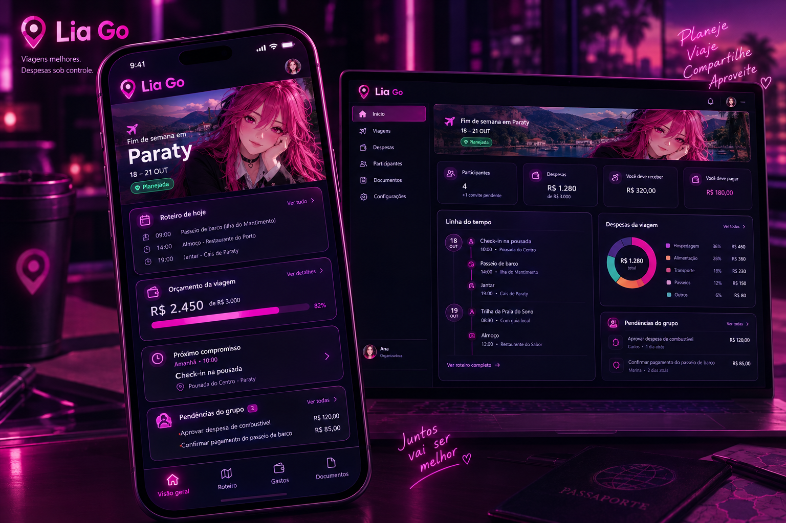

<p align="center">
  
</p>

<h1 align="center">Lia Go</h1>

<p align="center">
  <strong>Planeje viagens em grupo sem perder o controle dos planos e dos gastos.</strong><br>
  Roteiro, reservas, documentos, despesas compartilhadas e acertos em uma experiência pensada primeiro para o celular.
</p>

<p align="center">
  <a href="#organize-a-viagem-inteira">Recursos</a> ·
  <a href="#como-experimentar">Começar</a> ·
  <a href="#estado-do-projeto">Estado atual</a> ·
  <a href="docs/DEV_SETUP.md">Guia de uso</a>
</p>

> **Aplicativo em desenvolvimento.** Esta implementação está na branch de trabalho do Lia Go, em revisão para integração à `main` pela [PR #1](https://github.com/BloomRX/Lia-Go/pull/1). Não há APK de produção nem serviço público hospedado.

## Organize a viagem inteira

Do primeiro roteiro ao fechamento dos gastos, o Lia Go ajuda o grupo a manter os planos visíveis, registrar mudanças e tomar decisões em conjunto.

<p align="center">
  <br>
  <sub>Concept de referência visual; não é uma captura garantida da implementação atual.</sub>
</p>

## O que você pode fazer

| Para o grupo | Recursos disponíveis na branch de desenvolvimento |
| --- | --- |
| **Viagens e participantes** | Criar viagens, convidar pessoas e administrar permissões e participação. |
| **Roteiro** | Organizar atividades por dia, horários, deslocamentos, custos e conflitos de agenda. |
| **Reservas e documentos** | Registrar compromissos e comprovantes, com documentos privados por padrão. |
| **Orçamento** | Planejar limites e acompanhar custos estimados sem confundi-los com saldos oficiais. |
| **Despesas compartilhadas** | Dividir valores com regras explícitas; lançamento pendente só entra no saldo após confirmação de outra pessoa. |
| **Acertos** | Visualizar saldos e registrar pagamentos e confirmações; o app não movimenta dinheiro. |
| **Checklist** | Atribuir ações e registrar conclusão, sem concluir tarefas automaticamente pela passagem do tempo. |
| **Offline e sincronização** | Guardar alterações no aparelho e reenviar quando a conexão voltar; conflitos importantes dependem de decisão humana. |

A interface usa **React + TypeScript + Capacitor**, a API é **Fastify** e a persistência central usa **PostgreSQL**. O app Android é uma meta de distribuição; a experiência web é útil para desenvolvimento e testes.

## Um exemplo de uso

Crie uma viagem, convide os participantes, monte o roteiro e registre uma despesa compartilhada. Ela começa **pendente**. Outra pessoa do grupo revisa e confirma; só então a despesa entra no saldo oficial. Se dois aparelhos editarem a mesma informação offline, o Lia Go apresenta o conflito em vez de escolher silenciosamente uma versão.

**Não há pagamentos Pix nem reservas externas automáticas.** O produto organiza e registra decisões, mas não movimenta fundos nem compra serviços.

## Como experimentar

Para desenvolvimento, use **Node.js 22.12+** e uma instância local ou configurada de PostgreSQL.

No Windows, abra as opções de desenvolvimento sem iniciar o fluxo automático de sincronização do Git:

```powershell
.\LiaGo.bat menu
```

Escolha a opção **3 — Desenvolvimento**. Pelo terminal, as etapas básicas são:

```bash
npm install
npm run db:up
npm run migrate
npm run dev:api
npm run dev:web
```

API e web são iniciadas em terminais próprios. Os scripts possuem alternativas de banco local para Windows; veja o [guia de instalação](docs/DEV_SETUP.md) para requisitos e diagnóstico.

> **Atenção:** executar `LiaGo.bat` sem argumentos inicia uma rodada ampla que também pode validar, commitar e sincronizar a branch de trabalho no GitHub. Para apenas conhecer a interface, prefira o menu e a opção de desenvolvimento.

## Estado do projeto

A branch contém domínio, API, interface e testes de integração com PostgreSQL real. O [relatório de auditoria](reports/AUDITORIA-GERAL-LIA-GO.md) registra **462 testes aprovados na rodada de 21/10/2026** — não é uma garantia de que todos foram reexecutados hoje.

Antes de uso com dados reais ou publicação em lojas ainda faltam hospedagem HTTPS, backup/restauração validados, recuperação de conta, decisões LGPD e testes de build nativo em dispositivos. A camada de IA conversacional ainda não foi conectada; a presença da Lia na identidade visual não implica assistente executando operações.

## Guias e decisões

- [Primeiros passos e execução](docs/DEV_SETUP.md)
- [Produto e escopo](docs/PRODUCT_OVERVIEW.md)
- [Telas e navegação](docs/UX_SCREENS.md)
- [Arquitetura e segurança](docs/ARCHITECTURE.md)
- [Auditoria e evidências](reports/AUDITORIA-GERAL-LIA-GO.md)

## Ecossistema Lia e contribuição

O Lia Go é um aplicativo **independente**: não exige instalar a [Lia Desktop](https://github.com/BloomRX/Lia-Project), o [Lia Studio](https://github.com/BloomRX/Lia-Studio) ou o [Lia Agent Hub](https://github.com/BloomRX/Lia-AgentHub). Todos compartilham identidade de ecossistema, sem compartilhar obrigatoriamente o mesmo runtime.

Para desenvolvimento com agentes, consulte [`AGENTS.md`](AGENTS.md), [`docs/AGENTS.md`](docs/AGENTS.md) e as [decisões abertas](docs/DECISIONS_AND_OPEN_QUESTIONS.md). O README apresenta o aplicativo; a governança técnica fica nesses documentos.
